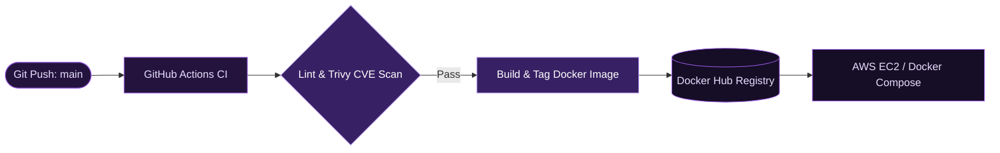

<div align="center">


<br/>


<br/><br/>

<a href="https://github.com/shubhamkadam039">
  
</a>
<a href="https://www.linkedin.com/in/shubhamkadam039/">
  
</a>

<br/><br/>

</div>


<div align="center">

## ABOUT ME

</div>

Systems-focused **BCA Graduate (2026)** specializing in **Linux administration, containerization, cloud infrastructure (AWS), and CI/CD automation**. Focused on eliminating manual deployment drift and maintaining reliable production environments.

- **Cloud & Infrastructure:** Provisioning and securing **AWS EC2, VPC, IAM, and S3** workloads.
- **Containerization:** Packaging multi-tier applications with **Docker** and **Docker Compose** (multi-stage builds, non-root users, persistent volumes).
- **CI/CD Automation:** Building automated lint, test, security scan, and image-push workflows using **GitHub Actions**.
- **Linux & Scripting:** Writing idempotent **Bash** scripts (`set -euo pipefail`) for service health checks, log auditing, and automated backups.
- **Experience:** Completed a **DevOps Internship at Elevate Labs**, working on containerized deployments and pipeline automation.

```bash
$ whoami
shubham-kadam

$ cat infra-profile.yml
role:        Cloud & DevOps Engineer
education:   BCA (2026 Graduate)
location:    Pune, Maharashtra, India
core_stack:  [Linux, Bash, Docker, GitHub Actions, AWS, Git]
exploring:   [Terraform, Kubernetes, Prometheus, Grafana]
status:      Open to DevOps / Cloud Support / SRE roles
```


<div align="center">

## TECH ARSENAL

<p>
  
</p>

</div>

| Domain | Operational Capabilities & Tools |
| :--- | :--- |
| **Linux & Shell** | Ubuntu/RHEL CLI, Bash automation, `systemd`/`journalctl`, `cron`, permissions (`chmod`/`chown`), socket auditing (`ss`/`netstat`) |
| **Containers** | Docker (multi-stage `Dockerfile`s, `.dockerignore`, Alpine bases), Docker Compose (custom bridge networks, volumes, healthchecks) |
| **CI/CD & DevSecOps** | GitHub Actions (YAML pipelines, Secrets management, automated image builds), Trivy container vulnerability scanning |
| **Cloud & IaC** | AWS (EC2, S3, IAM least-privilege policies, Security Groups, VPC fundamentals), Terraform (`init`, `plan`, `apply` workflows) |
| **Web, DB & Runtime** | Nginx (reverse proxy), PostgreSQL, MongoDB, Node.js/Express, Python, Next.js/React |


<div align="center">

## DEPLOYMENT PIPELINE ARCHITECTURE

</div>


