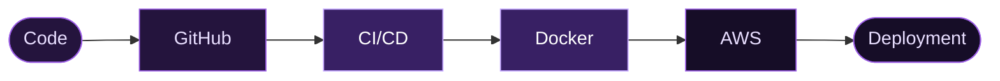

 <div align="center">


<br/>


<br/><br/>

<a href="https://github.com/YOUR_GITHUB_USERNAME">

</a>

<a href="YOUR_LINKEDIN_URL">

</a>


</div>


<div align="center">

## ABOUT ME

</div>

### Hello, I'm Shubham Kadam!

I'm a BCA student passionate about technology, cloud computing, and automation, currently working towards becoming a **DevOps and Cloud Engineer**.

I enjoy exploring how applications are developed, deployed, automated, and maintained in real-world environments.

- Cloud infrastructure and deployment using **AWS**.
- Containerization and application deployment using **Docker**.
- Learning CI/CD workflows and automation.
- Exploring Linux and system administration.
- Completed a **DevOps internship at Elevate Labs**.
- Interested in building practical projects and solving real-world problems.

```bash
$ whoami

shubham-kadam

$ cat profile.yml

role:       Aspiring DevOps Engineer
education:  BCA
focus:      Cloud & DevOps
interests:  Automation, CI/CD, Infrastructure
currently:  AWS, Docker, Linux, Kubernetes

$ echo $STATUS

Learning | Building | Improving
```

> Open to opportunities in DevOps, Cloud Engineering, and related technology roles.


<div align="center">

## TECH ARSENAL

</div>

### DevOps & Cloud

<p align="center">

</p>

### Development

<p align="center">

</p>

### Tools & Technologies

<p align="center">

</p>

| Domain | Technologies |
|:---|:---|
| Cloud | AWS (EC2) |
| Operating Systems | Linux |
| Version Control | Git, GitHub |
| Containers | Docker |
| CI/CD | GitHub Actions, CI/CD fundamentals |
| Development | HTML, CSS, JavaScript, React.js |
| Backend & Database | Node.js, Express.js, PostgreSQL |
| Programming | Python, JavaScript |
| Currently Exploring | Kubernetes, Terraform, Cloud Automation |


<div align="center">

## HOW I SHIP


</div>




<div align="center">

## FEATURED PROJECTS

</div>

### 01. AWS CI/CD Automation Project

Building an automated application deployment workflow using AWS and DevOps tools.

**Highlights**
- Application setup using Next.js.
- Git and GitHub version control.
- Docker-based application containerization.
- CI/CD pipeline implementation.
- Code
